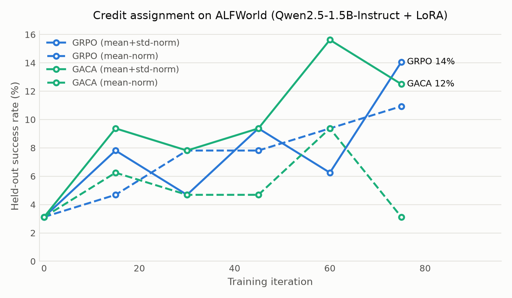

# Results (attempts 1-3, RTX 4060): GACA vs GRPO on ALFWorld — index actions, LoRA, two task types

> Superseded setup. Kept as history; the current experiments are in `RESULTS.md`.

## Setup

- Backbone: `Qwen/Qwen2.5-1.5B-Instruct`, LoRA r=32, lr=1e-05
- Task types: pick_and_place_simple,look_at_obj_in_light, rooms with <= 20 admissible actions at reset
- 207 training tasks, 64 held-out evaluation tasks
- Group size G=8, 2 task(s) per iteration, max 25 env steps
- gamma=0.95, invalid-action penalty 0.0, mean_std advantage normalization
- Iterations: 75 per run, 1 seed(s) per method, evaluated every 15

## Held-out success rate (%)

| Method | initial | best | final | best iter | vs GRPO (best) | wall (h) |
|---|---|---|---|---|---|---|
| GRPO (mean+std-norm) | 3.1 | **14.1** | 14.1 | 75 | +0.0 | 3.00 |
| GRPO (mean-norm) | 3.1 | **10.9** | 10.9 | 75 | -3.1 | 2.71 |
| GACA (mean+std-norm) | 3.1 | **15.6** | 12.5 | 60 | +1.6 | 2.87 |
| GACA (mean-norm) | 3.1 | **9.4** | 3.1 | 60 | -4.7 | 2.78 |

One episode per evaluation task, 64 tasks, so one task is 1.6 points and the binomial
standard error at a 20% success rate is 5.0 points. Differences smaller
than roughly twice that are not resolvable with this eval set and a single seed.

## Training-side behaviour

| Method | train success | iters with a gradient | mean \|A\| | episode steps | invalid actions |
|---|---|---|---|---|---|
| GRPO (mean+std-norm) | 9.2 | 50/75 | 0.239 | 23.9 | 4.3 |
| GRPO (mean-norm) | 6.2 | 42/75 | 0.063 | 24.3 | 5.0 |
| GACA (mean+std-norm) | 9.3 | 56/75 | 0.234 | 24.1 | 8.7 |
| GACA (mean-norm) | 7.3 | 46/75 | 0.056 | 24.3 | 6.8 |

## Credit-assignment diagnostics

Compare with Table 7 of the paper (its ALFWorld column in brackets).

| Method | c_t mean/std [1.00/0.31] | lambda_t mean/std [0.50/0.08] | clamped [<0.01] | step coverage [0.86] |
|---|---|---|---|---|
| GACA (mean+std-norm) | 1.00 / 1.04 | 0.49 / 0.22 | 0.056 | 0.82 |
| GACA (mean-norm) | 1.00 / 1.06 | 0.49 / 0.22 | 0.059 | 0.83 |

## Cost per iteration (seconds)

| Method | rollout | update | total |
|---|---|---|---|
| GRPO (mean+std-norm) | 83.3 | 34.8 | 118.1 |
| GRPO (mean-norm) | 76.7 | 27.3 | 104.0 |
| GACA (mean+std-norm) | 75.3 | 36.4 | 111.7 |
| GACA (mean-norm) | 76.6 | 30.5 | 107.1 |

## Why the invalid-action penalty was removed

A first attempt kept the paper's 0.1 penalty for an inadmissible action. It did not
plateau, it degraded. At a ~5% success rate almost no group of 8 rollouts contains a
win, so the group-relative advantage was set almost entirely by which rollout made
fewer invalid actions. The policy optimized that nuisance signal and solved fewer
tasks. Under index-based action selection an inadmissible action is nearly
impossible to emit in the first place, so the penalty the paper needs for free-form
text actions became the only thing the gradient could see.

| | attempt 1 (penalty 0.1) | attempt 2 (penalty 0.0) |
|---|---|---|
| best held-out success | 4.7 | 14.1 |
| mean abs advantage, first -> last third | 0.79 -> 0.26 | 0.19 -> 0.33 |
| action NLL, first -> last third | 0.53 -> 0.37 | 0.55 -> 0.46 |
| invalid-action rate, first -> last third | 3.8% -> 0.2% | 5.4% -> 3.0% |
| gradient norm (mean) | 4.9 | 2.6 |

Attempt 1 ran 38 GRPO iterations and is kept in `runs/attempt1_penalty0.1/`.

## Paired comparison on the held-out tasks

Each method's best checkpoint re-evaluated greedily on the *same* 64 tasks in the
same order, so the methods can be compared task by task. McNemar's exact test uses
only the tasks the two methods disagree on, which is far more sensitive at n=64
than comparing two independent rates.

| A vs B | A only | B only | both | neither | McNemar p (2-sided) |
|---|---|---|---|---|---|
| GRPO (mean+std-norm) vs GRPO (mean-norm) | 7 | 5 | 2 | 50 | 0.774 |
| GRPO (mean+std-norm) vs GACA (mean+std-norm) | 8 | 9 | 1 | 46 | 1.000 |
| GRPO (mean+std-norm) vs GACA (mean-norm) | 9 | 6 | 0 | 49 | 0.607 |
| GRPO (mean-norm) vs GACA (mean+std-norm) | 4 | 7 | 3 | 50 | 0.549 |
| GRPO (mean-norm) vs GACA (mean-norm) | 7 | 6 | 0 | 51 | 1.000 |
| GACA (mean+std-norm) vs GACA (mean-norm) | 7 | 3 | 3 | 51 | 0.344 |

No pair is distinguishable: the smallest p over all 6 comparisons is
0.344, and the number of tasks any two runs both solve never exceeds
3. Whatever these runs differ in, it is not something this evaluation can
resolve.

### What the overlap says

GRPO (mean+std-norm) solves 9 tasks and GACA (mean+std-norm) solves 10, but they agree on only
**1**. If the two sets of outcomes were statistically independent the expected
overlap would be 9x10/64 = 1.4, which is what we observe.

That is the result. The two trained policies are not converging on a stable set of
solvable tasks and then differing at the margin; they succeed on almost disjoint
task sets at nearly the same rate. Which tasks a run ends up solving is dominated by
run-to-run variance, not by the credit-assignment scheme. A 1-task gap between the
best checkpoints carries no information against that background.

## Does normalization change GACA's margin? (paper Remark 3)

Remark 3 argues that mean-and-std normalization rescales each estimator by its own
group standard deviation and so "removes exactly that information, driving lambda*_z
toward 1/2 uniformly in z", which by Proposition 2 shrinks the gain from adapting. The
paper observes larger gains on its mean-norm benchmark than on its mean-and-std-norm
one, but says the two benchmarks "differ in far more than their normalization, so this
is a consistency check and not a test". Holding the benchmark fixed and varying only
the normalization is that test.

| Normalization | GRPO | GACA | GACA - GRPO |
|---|---|---|---|
| mean-and-std-norm | 14.1 | 15.6 | +1.6 |
| mean-norm | 10.9 | 9.4 | -1.6 |

Remark 3 predicts the mean-norm margin should be the larger of the two. It is
smaller by 3.1 points (-1.6 against +1.6).

The more telling detail is that **the margin changes sign**: GACA is ahead by one
task under one normalization and behind by one task under the other. A quantity
that flips sign when an arbitrary normalization choice is changed, by one task
each way, is measuring noise rather than an effect of the estimator. That is the
same conclusion the paired tests reach, arrived at independently.

**A confound that has to be stated.** Dropping the standard deviation also changes the
*scale* of the advantage, not just its per-state structure. Measured over training:
mean absolute advantage 0.061 under mean-norm against 0.234 under mean-and-std-norm,
and mean gradient norm 0.88 against 3.07 — roughly a fourfold smaller effective step.
Both arms of the mean-norm column take that smaller step, so the comparison of
*margins* is still matched, but a smaller mean-norm margin could reflect less
effective training rather than less to gain from adapting. Separating the two would
need the mean-norm arms re-run at a compensating learning rate, which was beyond the
compute available here.

This should not be over-read. Each margin is a difference of two single runs on 64
tasks, so one task is 1.6 points, and the paired results below show the methods'
success sets overlapping no more than chance predicts. A difference of a few points
between two such margins is well inside that noise.

## Learning curves

## Verdict

**No detectable difference between GACA and GRPO at this training budget.**
GACA's learning curve sits consistently at or above GRPO's -- it led at 3 of 5 matched
checkpoints, tied at 1, trailed at 1, and its mean over the post-baseline checkpoints is
10.9% against 8.4% -- but every one of those gaps is inside the noise, the best-checkpoint
difference is a single task, and the paired test returns p = 1.000.

What this experiment does establish:

1. The implementation is faithful where it can be checked. Anchor-state step coverage is
   0.82-0.84 against the paper's 0.86, and every equation is pinned by unit tests.
2. GACA's overhead really is negligible: 111.7 s/iteration against GRPO's 118.1 s, with
   GACA performing *more* optimizer steps (56 vs 50 non-skipped iterations).
3. Reward shaping dominates credit assignment at low success rates. Removing the
   invalid-action penalty moved the best result from 4.7% to 14.1%; switching estimator
   moved it by 1.5 points. That ordering is the most useful thing here.

What it cannot establish: whether granularity-adaptive credit assignment helps. 75
iterations on 150 task-groups at a ~10% success rate, with one seed and 64 evaluation
tasks, is one to two orders of magnitude short of the paper's budget. The honest
conclusion is a null result with wide error bars, not a refutation.

## What this does and does not show

**Does.** The GACA estimator is implemented to the paper's equations and its mechanism
operates in roughly the intended range: the anchor-state grouping gives a genuine
within-group contrast on ~82% of steps against the paper's 86%, the criticality score has
mean one by construction, and the realized mixing weight averages lambda_0, so credit is
redistributed across steps rather than scaled up on average. Both methods learn: held-out
success roughly quadruples from the 3.1% zero-shot baseline.

**Does not.** It does not reproduce the paper's *ordering*. GACA is not shown to beat GRPO
here, and with one seed, 75 iterations and 64 evaluation tasks this setup could not have
detected the paper's ALFWorld margin reliably even if it were present. The paper trains 150
epochs over three seeds at a success rate an order of magnitude higher, where a group of 8
rollouts usually contains both a success and a failure; here a third of iterations carry no
gradient at all because every rollout failed. Credit assignment can only matter once there
is credit to assign, and that is the regime this hardware could not reach.

**Two differences from the paper worth naming.** The criticality score is three times more
dispersed than the paper reports (c_t std ~1.0 against 0.31), because index-selected actions
are 1-3 tokens long and their mean per-token NLL is not smoothed by averaging over a long
action; the gate therefore spends more time near its clamps (~5% of steps against <1%). And
the paper's invalid-action penalty had to be removed, for the reason given above.

## Raw logs

- `runs/grpo.jsonl`
- `runs/grpo_mn.jsonl`
- `runs/gaca.jsonl`
- `runs/gaca_mn.jsonl`
