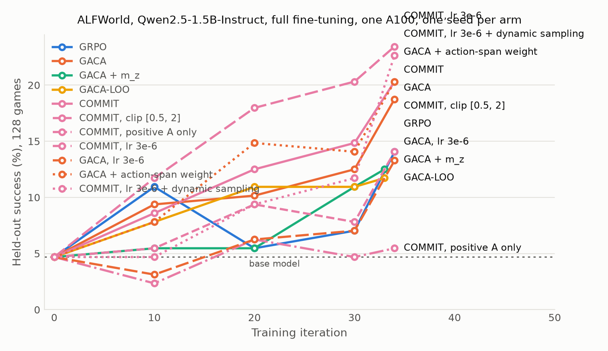

# Results: GACA vs GRPO, and new credit-assignment treatments, on ALFWorld

Generated by `python src/report.py` from `src/runs/verl/` and `src/runs/tokens/`; do not edit by hand.
Judgement calls and their measurements are in `DECISIONS.md`; ideas and reasoning in `IDEAS.md`.
Earlier attempts (RTX 4060: index actions, LoRA, two task types) are in `RESULTS_4060.md`.

## Setup shared by every arm

verl-agent (the paper's pipeline) on one A100 40 GB. Qwen2.5-1.5B-Instruct, full fine-tuning, lr 1e-6,
the paper's `<think>`/`<action>` prompt with a 512-token response cap, 50 environment steps, group size 8,
gamma 0.95, KL 0.01 (low-variance), invalid-action penalty 0.1, mean-and-std normalization, PPO mini-batch
256. **4 tasks x 8 rollouts per iteration (paper: 16 x 8), 34 iterations (paper: 150), one seed (paper: 3)**
-- ~1,088 trajectories per arm, ~6% of the paper's 19,200. All six ALFWorld task types; every evaluation is
the **same 128 in-distribution games**, one episode each, sampled at T = 0.4, so arms are compared task by
task (exact McNemar). Arms differ only in the advantage estimator (`algorithm.gaca.*`). One evaluation game
is 0.78 points.

## Arms

| arm | role | differs from the controls by | status | iterations | train h | final success | best (iter) |
|---|---|---|---|---|---|---|---|
| base model | reference | no training | done | 0 | 0 | **4.7%** (6/128) | -- |
| GRPO | control | episode-level advantage only (Eq. 2) | done | 34 | 3.68 | **14.1%** (18/128) | 14.1% (34) |
| GACA | control | the paper's estimator: NLL-gated mix of step and episode advantage (Eq. 8) | done | 34 | 3.67 | **18.8%** (24/128) | 18.8% (34) |
| GACA + m_z | treatment | GACA, lambda odds scaled by 1 - 1/m_z (anchor-group size; Prop. 3) | done | 33 | 3.61 | **12.5%** (16/128) | 12.5% (33) |
| GACA-LOO | treatment | GACA, criticality = leave-one-out mean NLL of the other visits (App. B.4) | done | 33 | 3.60 | **11.7%** (15/128) | 11.7% (33) |
| COMMIT | treatment | GACA, step advantage spread over tokens by the commitment probe (training seed 1) | done | 34 | 5.19 | **20.3%** (26/128) | 20.3% (34) |
| COMMIT, clip [0.5, 2] | treatment | probe with token weights clipped to [0.5, 2] instead of [0.25, 4] | done | 34 | 4.96 | **14.1%** (18/128) | 14.1% (34) |
| COMMIT, positive A only | treatment | probe weights only on steps with a positive advantage; others uniform | done | 34 | 4.98 | **5.5%** (7/128) | 6.2% (20) |
| COMMIT, lr 3e-6 | hill-climb | COMMIT (as commit_s1) with learning rate 3e-6 instead of 1e-6 | done | 34 | 4.66 | **23.4%** (30/128) | 23.4% (34) |
| GACA, lr 3e-6 | hill-climb | GACA with learning rate 3e-6 instead of 1e-6 | done | 34 | 3.63 | **13.3%** (17/128) | 13.3% (34) |
| GACA + action-span weight | hill-climb | probe-free token weights: <action> span 2x, reasoning 1x, mean 1 | done | 34 | 3.64 | **20.3%** (26/128) | 20.3% (34) |
| COMMIT, lr 3e-6 + dynamic sampling | hill-climb | COMMIT at lr 3e-6, groups with all-equal rewards dropped and refilled (DAPO), up to 3 passes | done | 34 | 8.85 | **22.7%** (29/128) | 22.7% (34) |

Final = the last evaluation (the end-of-training checkpoint). Best is reported for comparison with the
paper's best-checkpoint convention but is optimistic: it picks the maximum over five noisy evaluations.

### Learning curves (held-out success %, 128 games)

| arm | iter 0 | iter 10 | iter 20 | iter 30 | final (iter) |
|---|---|---|---|---|---|
| GRPO | 4.7 | 10.9 | 5.5 | 7.0 | 14.1 (34) |
| GACA | 4.7 | 9.4 | 10.2 | 12.5 | 18.8 (34) |
| GACA + m_z | 4.7 | 5.5 | 5.5 | 10.9 | 12.5 (33) |
| GACA-LOO | 4.7 | 7.8 | 10.9 | 10.9 | 11.7 (33) |
| COMMIT | 4.7 | 8.6 | 12.5 | 14.8 | 20.3 (34) |
| COMMIT, clip [0.5, 2] | 4.7 | 5.5 | 9.4 | 7.8 | 14.1 (34) |
| COMMIT, positive A only | 4.7 | 2.3 | 6.2 | 4.7 | 5.5 (34) |
| COMMIT, lr 3e-6 | 4.7 | 11.7 | 18.0 | 20.3 | 23.4 (34) |
| GACA, lr 3e-6 | 4.7 | 3.1 | 6.2 | 7.0 | 13.3 (34) |
| GACA + action-span weight | 4.7 | 7.8 | 14.8 | 14.1 | 20.3 (34) |
| COMMIT, lr 3e-6 + dynamic sampling | 4.7 | 4.7 | 9.4 | 11.7 | 22.7 (34) |

## Paired comparison of final checkpoints

Exact two-sided McNemar on the 128 shared games; `A only` / `B only` are the games one arm solves and
the other does not. The base model is each arm's own iteration-0 evaluation.

| A vs B | A | B | A only | B only | both | p |
|---|---|---|---|---|---|---|
| base model vs GRPO | 6 | 18 | 6 | 18 | 0 | 0.023 |
| base model vs GACA | 6 | 24 | 4 | 22 | 2 | 0.001 |
| base model vs GACA + m_z | 6 | 16 | 6 | 16 | 0 | 0.052 |
| base model vs GACA-LOO | 6 | 15 | 5 | 14 | 1 | 0.064 |
| base model vs COMMIT | 6 | 26 | 6 | 26 | 0 | 0.001 |
| base model vs COMMIT, clip [0.5, 2] | 6 | 18 | 5 | 17 | 1 | 0.017 |
| base model vs COMMIT, positive A only | 6 | 7 | 6 | 7 | 0 | 1.000 |
| base model vs COMMIT, lr 3e-6 | 6 | 30 | 4 | 28 | 2 | 0.000 |
| base model vs GACA, lr 3e-6 | 6 | 17 | 5 | 16 | 1 | 0.027 |
| base model vs GACA + action-span weight | 6 | 26 | 4 | 24 | 2 | 0.000 |
| base model vs COMMIT, lr 3e-6 + dynamic sampling | 6 | 29 | 4 | 27 | 2 | 0.000 |
| GRPO vs GACA | 18 | 24 | 7 | 13 | 11 | 0.263 |
| GRPO vs GACA + m_z | 18 | 16 | 13 | 11 | 5 | 0.839 |
| GRPO vs GACA-LOO | 18 | 15 | 11 | 8 | 7 | 0.648 |
| GRPO vs COMMIT | 18 | 26 | 8 | 16 | 10 | 0.152 |
| GRPO vs COMMIT, clip [0.5, 2] | 18 | 18 | 13 | 13 | 5 | 1.000 |
| GRPO vs COMMIT, positive A only | 18 | 7 | 16 | 5 | 2 | 0.027 |
| GRPO vs COMMIT, lr 3e-6 | 18 | 30 | 8 | 20 | 10 | 0.036 |
| GRPO vs GACA, lr 3e-6 | 18 | 17 | 11 | 10 | 7 | 1.000 |
| GRPO vs GACA + action-span weight | 18 | 26 | 9 | 17 | 9 | 0.169 |
| GRPO vs COMMIT, lr 3e-6 + dynamic sampling | 18 | 29 | 8 | 19 | 10 | 0.052 |
| GACA vs GACA + m_z | 24 | 16 | 17 | 9 | 7 | 0.169 |
| GACA vs GACA-LOO | 24 | 15 | 14 | 5 | 10 | 0.064 |
| GACA vs COMMIT | 24 | 26 | 14 | 16 | 10 | 0.856 |
| GACA vs COMMIT, clip [0.5, 2] | 24 | 18 | 16 | 10 | 8 | 0.327 |
| GACA vs COMMIT, positive A only | 24 | 7 | 20 | 3 | 4 | 0.000 |
| GACA vs COMMIT, lr 3e-6 | 24 | 30 | 12 | 18 | 12 | 0.362 |
| GACA vs GACA, lr 3e-6 | 24 | 17 | 12 | 5 | 12 | 0.143 |
| GACA vs GACA + action-span weight | 24 | 26 | 11 | 13 | 13 | 0.839 |
| GACA vs COMMIT, lr 3e-6 + dynamic sampling | 24 | 29 | 9 | 14 | 15 | 0.405 |
| GACA + m_z vs GACA-LOO | 16 | 15 | 10 | 9 | 6 | 1.000 |
| GACA + m_z vs COMMIT | 16 | 26 | 6 | 16 | 10 | 0.052 |
| GACA + m_z vs COMMIT, clip [0.5, 2] | 16 | 18 | 8 | 10 | 8 | 0.815 |
| GACA + m_z vs COMMIT, positive A only | 16 | 7 | 11 | 2 | 5 | 0.022 |
| GACA + m_z vs COMMIT, lr 3e-6 | 16 | 30 | 6 | 20 | 10 | 0.009 |
| GACA + m_z vs GACA, lr 3e-6 | 16 | 17 | 8 | 9 | 8 | 1.000 |
| GACA + m_z vs GACA + action-span weight | 16 | 26 | 7 | 17 | 9 | 0.064 |
| GACA + m_z vs COMMIT, lr 3e-6 + dynamic sampling | 16 | 29 | 9 | 22 | 7 | 0.029 |
| GACA-LOO vs COMMIT | 15 | 26 | 8 | 19 | 7 | 0.052 |
| GACA-LOO vs COMMIT, clip [0.5, 2] | 15 | 18 | 8 | 11 | 7 | 0.648 |
| GACA-LOO vs COMMIT, positive A only | 15 | 7 | 13 | 5 | 2 | 0.096 |
| GACA-LOO vs COMMIT, lr 3e-6 | 15 | 30 | 9 | 24 | 6 | 0.014 |
| GACA-LOO vs GACA, lr 3e-6 | 15 | 17 | 10 | 12 | 5 | 0.832 |
| GACA-LOO vs GACA + action-span weight | 15 | 26 | 8 | 19 | 7 | 0.052 |
| GACA-LOO vs COMMIT, lr 3e-6 + dynamic sampling | 15 | 29 | 8 | 22 | 7 | 0.016 |
| COMMIT vs COMMIT, clip [0.5, 2] | 26 | 18 | 16 | 8 | 10 | 0.152 |
| COMMIT vs COMMIT, positive A only | 26 | 7 | 22 | 3 | 4 | 0.000 |
| COMMIT vs COMMIT, lr 3e-6 | 26 | 30 | 9 | 13 | 17 | 0.523 |
| COMMIT vs GACA, lr 3e-6 | 26 | 17 | 15 | 6 | 11 | 0.078 |
| COMMIT vs GACA + action-span weight | 26 | 26 | 12 | 12 | 14 | 1.000 |
| COMMIT vs COMMIT, lr 3e-6 + dynamic sampling | 26 | 29 | 14 | 17 | 12 | 0.720 |
| COMMIT, clip [0.5, 2] vs COMMIT, positive A only | 18 | 7 | 14 | 3 | 4 | 0.013 |
| COMMIT, clip [0.5, 2] vs COMMIT, lr 3e-6 | 18 | 30 | 6 | 18 | 12 | 0.023 |
| COMMIT, clip [0.5, 2] vs GACA, lr 3e-6 | 18 | 17 | 9 | 8 | 9 | 1.000 |
| COMMIT, clip [0.5, 2] vs GACA + action-span weight | 18 | 26 | 6 | 14 | 12 | 0.115 |
| COMMIT, clip [0.5, 2] vs COMMIT, lr 3e-6 + dynamic sampling | 18 | 29 | 12 | 23 | 6 | 0.090 |
| COMMIT, positive A only vs COMMIT, lr 3e-6 | 7 | 30 | 1 | 24 | 6 | 0.000 |
| COMMIT, positive A only vs GACA, lr 3e-6 | 7 | 17 | 2 | 12 | 5 | 0.013 |
| COMMIT, positive A only vs GACA + action-span weight | 7 | 26 | 2 | 21 | 5 | 0.000 |
| COMMIT, positive A only vs COMMIT, lr 3e-6 + dynamic sampling | 7 | 29 | 2 | 24 | 5 | 0.000 |
| COMMIT, lr 3e-6 vs GACA, lr 3e-6 | 30 | 17 | 17 | 4 | 13 | 0.007 |
| COMMIT, lr 3e-6 vs GACA + action-span weight | 30 | 26 | 14 | 10 | 16 | 0.541 |
| COMMIT, lr 3e-6 vs COMMIT, lr 3e-6 + dynamic sampling | 30 | 29 | 13 | 12 | 17 | 1.000 |
| GACA, lr 3e-6 vs GACA + action-span weight | 17 | 26 | 3 | 12 | 14 | 0.035 |
| GACA, lr 3e-6 vs COMMIT, lr 3e-6 + dynamic sampling | 17 | 29 | 5 | 17 | 12 | 0.017 |
| GACA + action-span weight vs COMMIT, lr 3e-6 + dynamic sampling | 26 | 29 | 12 | 15 | 14 | 0.701 |

### Final success by task type

| arm | look at obj in light | pick and place simple | pick clean then place in recep | pick cool then place in recep | pick heat then place in recep | pick two obj and place |
|---|---|---|---|---|---|---|
| base model | 0/12 | 4/28 | 1/25 | 1/27 | 0/14 | 0/22 |
| GRPO | 1/9 | 11/40 | 0/23 | 4/18 | 2/11 | 0/27 |
| GACA | 2/9 | 13/40 | 2/23 | 3/18 | 3/11 | 1/27 |
| GACA + m_z | 2/9 | 8/40 | 3/23 | 2/18 | 0/11 | 1/27 |
| GACA-LOO | 1/9 | 8/40 | 0/23 | 3/18 | 2/11 | 1/27 |
| COMMIT | 4/9 | 11/40 | 6/23 | 4/18 | 0/11 | 1/27 |
| COMMIT, clip [0.5, 2] | 2/9 | 9/40 | 4/23 | 3/18 | 0/11 | 0/27 |
| COMMIT, positive A only | 0/9 | 4/40 | 2/23 | 1/18 | 0/11 | 0/27 |
| COMMIT, lr 3e-6 | 4/9 | 15/40 | 8/23 | 1/18 | 0/11 | 2/27 |
| GACA, lr 3e-6 | 3/9 | 9/40 | 4/23 | 1/18 | 0/11 | 0/27 |
| GACA + action-span weight | 3/9 | 12/40 | 7/23 | 2/18 | 0/11 | 2/27 |
| COMMIT, lr 3e-6 + dynamic sampling | 3/9 | 16/40 | 3/23 | 2/18 | 2/11 | 3/27 |

## Training diagnostics (mean over iterations)

| arm | s / iter | probe s / iter | valid actions | response tokens | KL (last 5) | c_t std | lambda std | step coverage | q(0) first 5 -> last 5 | CIR |
|---|---|---|---|---|---|---|---|---|---|---|
| GRPO | 390 | -- | 99.2% | 80 | 0.033 | -- | -- | -- | -- | -- |
| GACA | 389 | -- | 99.2% | 84 | 0.027 | 0.35 | 0.087 | 0.96 | -- | -- |
| GACA + m_z | 393 | -- | 99.1% | 84 | 0.029 | 0.36 | 0.134 | 0.96 | -- | -- |
| GACA-LOO | 393 | -- | 99.1% | 82 | 0.039 | 0.16 | 0.039 | 0.96 | -- | -- |
| COMMIT | 550 | 151 | 99.2% | 91 | 0.034 | 0.36 | 0.090 | 0.96 | 0.19 -> 0.14 | -- |
| COMMIT, clip [0.5, 2] | 525 | 131 | 99.1% | 81 | 0.021 | 0.37 | 0.092 | 0.96 | 0.20 -> 0.18 | 0.11 -> 0.10 |
| COMMIT, positive A only | 527 | 137 | 99.2% | 78 | 0.059 | 0.36 | 0.089 | 0.96 | 0.20 -> 0.19 | 0.11 -> 0.09 |
| COMMIT, lr 3e-6 | 493 | 127 | 99.3% | 75 | 0.123 | 0.39 | 0.098 | 0.95 | 0.18 -> 0.26 | 0.11 -> 0.09 |
| GACA, lr 3e-6 | 384 | -- | 99.3% | 79 | 0.118 | 0.36 | 0.091 | 0.96 | -- | -- |
| GACA + action-span weight | 386 | -- | 99.2% | 82 | 0.023 | 0.36 | 0.091 | 0.96 | -- | -- |
| COMMIT, lr 3e-6 + dynamic sampling | 937 | 183 | 99.3% | 84 | 0.160 | 0.37 | 0.091 | 0.97 | 0.22 -> 0.05 | 0.10 -> 0.11 |

Paper Table 7 (ALFWorld): c_t std 0.31, lambda std 0.08, clamped < 0.01, step coverage 0.86.
q(0): probability of the eventual action before any reasoning (probe arms). CIR: Causal Importance of
Reasoning (Yu et al., 2026), mean JS divergence between the probe at each cut and at the full reasoning;
logged from `commit_c05` on. A rising q(0) / falling CIR means the reasoning matters less over training.

## Offline studies (no training)

### Is GACA's step score noise? (sampled NLL vs exact token entropy)

7,864 step rows from the first 5 iterations of a GACA-policy run. Both scores come from the same
forward pass on the same responses.

| quantity | value |
|---|---|
| correlation NLL vs exact entropy (Pearson / within-trajectory Spearman) | 0.94 / 0.90 |
| steps whose lambda moves > 0.1 when NLL is replaced by exact entropy | 0.9% |
| share of the score's variance that is within-state (repeated visits), NLL / entropy | 87% / 85% |
| share of a response's entropy carried by its top-20% tokens | 52% |

Reading: swapping the step gate's signal changes almost nothing, but most of either score is
path-dependent noise rather than a property of the state.

### Which tokens decide the action? (flip-test oracle)

For real steps of the base policy, the response is cut after j tokens and the rest resampled 8 times;
F(j) = P(final action changes). The drop of F across a segment is that segment's decision importance.
Token-weighting schemes are scored by how much of their credit lands on decision importance, relative to
uniform credit (= GACA), and by total-variation distance to importance (lower is better).

| scheme | first run (48 games) credit vs uniform | held-out run (48 new games) credit vs uniform | held-out TV - uniform [95% CI] |
|---|---|---|---|
| uniform | 1.00x | 1.00x | +0.000 [+0.000, +0.000] |
| entropy | 1.02x | 1.04x | +0.011 [+0.003, +0.018] |
| nll | 1.07x | 1.07x | +0.026 [+0.016, +0.036] |
| action_span | 1.04x | 1.05x | +0.000 [-0.003, +0.003] |
| hybrid | -- | 1.07x | +0.005 [-0.002, +0.011] |
| probe | -- | 2.94x | -0.065 [-0.093, -0.037] |

Decision importance inside the `<action>` tags: 18%; fully resampling a
response changes the action 72% of the time. The hybrid was designed from the first run and
did not hold up out of sample. The probe column is unclipped segment mass.

### Does the probe still work on a trained policy?

The same oracle on the same 48 held-out games, with the final weights of the COMMIT arm in place
of the base model.

| | base policy | trained (COMMIT) |
|---|---|---|
| probe credit on decision importance vs uniform (unclipped) | 2.94x | 3.09x |
| same, training configuration (clip [0.25, 4]) [95% CI] | 1.65x [1.57, 1.74] | 1.64x [1.55, 1.72] |
| probe TV - uniform [95% CI] | -0.065 | -0.060 [-0.085, -0.034] |
| entropy credit vs uniform | 1.04x | 1.02x |
| decision importance inside `<action>` | 18% | 21% |

Training did not degrade the probe as a measurement.

### Robustness of probe weights at the training configuration

Exact training function (`advantages.probe_token_weights`, clip [0.25, 4], mean-preserving) on the held-out run.

| slice | steps | credit on importance vs uniform [95% CI] | steps where probe > uniform |
|---|---|---|---|
| spacing: x1 | 320 | 1.66x [1.57, 1.75] | 77% |
| spacing: x2 | 320 | 1.65x [1.57, 1.74] | 80% |
| spacing: x3 | 320 | 1.53x [1.45, 1.60] | 75% |
| clip: none | 320 | 2.18x [1.99, 2.37] | 79% |
| clip: 0.1-10 | 320 | 2.06x [1.90, 2.22] | 79% |
| clip: 0.25-4 | 320 | 1.65x [1.57, 1.74] | 80% |
| clip: 0.5-2 | 320 | 1.26x [1.23, 1.29] | 81% |
| task_type: look_at_obj_in_light | 25 | 1.96x [1.64, 2.30] | 88% |
| task_type: pick_and_place_simple | 100 | 1.72x [1.57, 1.87] | 85% |
| task_type: pick_clean_then_place_in_recep | 46 | 1.59x [1.39, 1.80] | 83% |
| task_type: pick_cool_then_place_in_recep | 45 | 1.62x [1.39, 1.88] | 76% |
| task_type: pick_heat_then_place_in_recep | 57 | 1.52x [1.31, 1.74] | 68% |
| task_type: pick_two_obj_and_place | 47 | 1.62x [1.42, 1.84] | 81% |
| step_t: early(t<=22) | 162 | 1.69x [1.57, 1.81] | 82% |
| step_t: late | 158 | 1.62x [1.50, 1.75] | 78% |
| openness_F0: settled | 131 | 1.33x [1.24, 1.42] | 73% |
| openness_F0: middle | 107 | 1.52x [1.40, 1.65] | 79% |
| openness_F0: open | 82 | 2.37x [2.17, 2.55] | 94% |
| split_half: half0 | 166 | 1.73x [1.61, 1.86] | 82% |
| split_half: half1 | 154 | 1.57x [1.46, 1.69] | 78% |

## Runs that are not results

- `src/runs/verl/gaca_random/`: GACA with the criticality score permuted within each trajectory (the paper's
  Table 2 ablation, which the paper already reports at 88.54 vs 96.88). Stopped at iteration 10 because it
  duplicates published work; its first-5-iteration step dump is the data of the entropy study above.
- `src/runs/verl/save_smoke/`: integration test of the final-weights upload (1 iteration, 16-game evaluation).
- `src/runs/a100/zs_*`: zero-shot prompt-format tests on the HF pipeline (two task types), see DECISIONS.md; code in legacy/4060_hf_pipeline/.

## Caveats

- **One seed per arm.** Earlier on this benchmark two seeds of one
  method differed by more than most gaps here; read p-values, not point differences.
- **~6% of the paper's training budget.** Every curve is still rising at the end; absolute numbers are not
  comparable to the paper's (96.88% for GACA at 1.5B). See DECISIONS.md for why the budget is what it is.
- **Matched on iterations (rollout budget), not wall-clock.** The probe arm takes ~50% longer per iteration.
  GACA + m_z and GACA-LOO ran under the 3.75 h wall-clock cap and stopped at 33 iterations, one short of
  the controls' 34 (~3% less data); the probe arms are fixed at 34.
- Offline token studies use the **base** policy (no trained checkpoint existed then).
